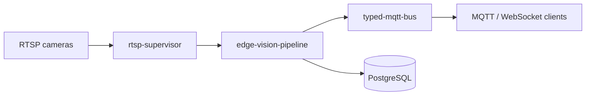

### Hi, I'm Robin

I build backend systems in Python that deal with messy, real-time inputs: video streams that drop,
brokers that restart, consumers that fall behind. I also work on the front end with React and
TypeScript.

What I care about when I write code:

- **Failure is a feature to design.** Reconnects, back-pressure, timeouts and clean shutdown are
  part of the first version, not an afterthought.
- **Tests that find bugs.** Unit tests for behaviour, property-based tests for invariants,
  integration tests against real databases and brokers, end-to-end checks in CI.
- **Types and small interfaces.** `mypy --strict`, protocols over inheritance, components that can
  be swapped and tested in isolation.

#### Featured: a real-time video analytics stack

Three repositories that build on each other, each usable on its own.

| Project | What it is | Highlights |
| --- | --- | --- |
| [edge-vision-pipeline](https://github.com/RobinChiHsu/edge-vision-pipeline) | Video analytics service: detection, tracking, zone and line rules, events over REST, WebSocket and MQTT | ONNX YOLO with NumPy pre/post-processing, IoU tracker with motion prediction, isolated event delivery, keyset pagination, docker compose demo verified end to end in CI |
| [rtsp-supervisor](https://github.com/RobinChiHsu/rtsp-supervisor) | Keeps RTSP and video sources flowing in asyncio apps | Reconnect with backoff and jitter, stall detection, latest-frame delivery, credential redaction |
| [typed-mqtt-bus](https://github.com/RobinChiHsu/typed-mqtt-bus) | Typed pub/sub over MQTT with pydantic models | Topic templates, shared subscriptions, invalid payload isolation, subscription replay after reconnect, in-memory broker for tests |

#### Tools I reach for

Python · asyncio · FastAPI · SQLAlchemy · PostgreSQL · MQTT · OpenCV · NumPy · Docker ·
React · TypeScript · GitHub Actions
